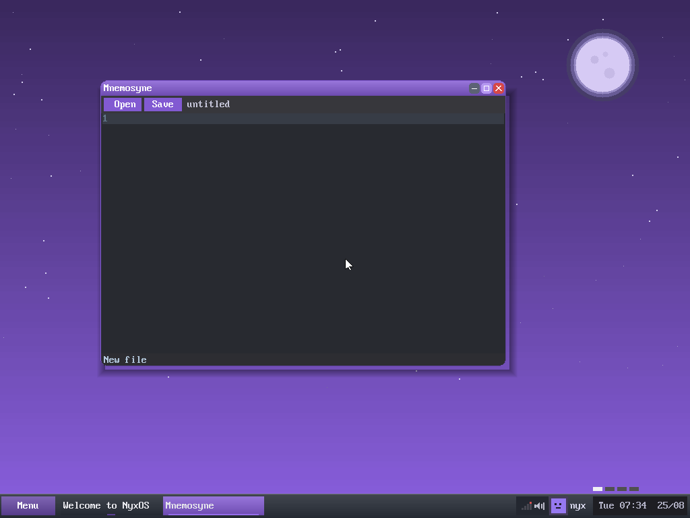

  

<strong>The text editor of NyxOS — open, edit and save files from the desktop.</strong>

  
  &nbsp;
  
  &nbsp;
  
  &nbsp;
  

---

## About

**Mnemosyne** — named for the goddess of *memory*, mother of the Muses — is the text editor of NyxOS. It is the everyday way to read and write files on the desktop: a scrolling text buffer with line numbers, a cursor and line editing, an **Open** and **Save** bar, and the ext2 filesystem underneath.

It pairs with the in-OS `cc` toolchain: write a C (or `.n`) file in Mnemosyne, then compile and install it with `xbm` from Erebus, without ever leaving NyxOS.

  
  
<em>Mnemosyne on the NyxOS desktop — Open / Save, line numbers and a fresh buffer</em>

## Features

- **Text buffer** with line numbers, a cursor, insertion, deletion and scrolling
- **Open / Save** to the ext2 filesystem, with the current path shown in the toolbar
- Keyboard-driven editing through the compositor's key callback
- Opens as an ordinary Hemera window

## Architecture

Mnemosyne is one of the apps that live on top of **[Hemera](https://github.com/nyxos-dev/hemera)**, the NyxOS compositor. Today it is compiled into the kernel under `kernel/gui/apps/editor_win.c`; the roadmap is a standalone ring-3 ELF that opens its window through the window syscalls. This repository holds a source snapshot (`src/`).

| Component | Repo | Role |
|-----------|------|------|
| **Hemera** | [hemera](https://github.com/nyxos-dev/hemera) | the compositor / desktop |
| **Erebus** | [erebus](https://github.com/nyxos-dev/erebus) | the terminal |
| **Selene** | [selene](https://github.com/nyxos-dev/selene) | the web browser |
| **Mnemosyne** | *(here)* | the text editor |

## Layout

- `src/editor_win.c` — the editor: buffer, rendering, input, open/save
- `src/editor_win.h` — the public interface

## Status

Built into the NyxOS kernel and running on the desktop today; the standalone-ELF split is the roadmap.
